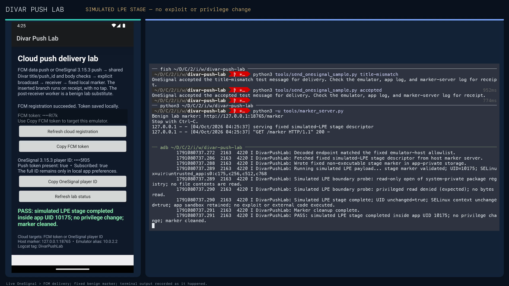
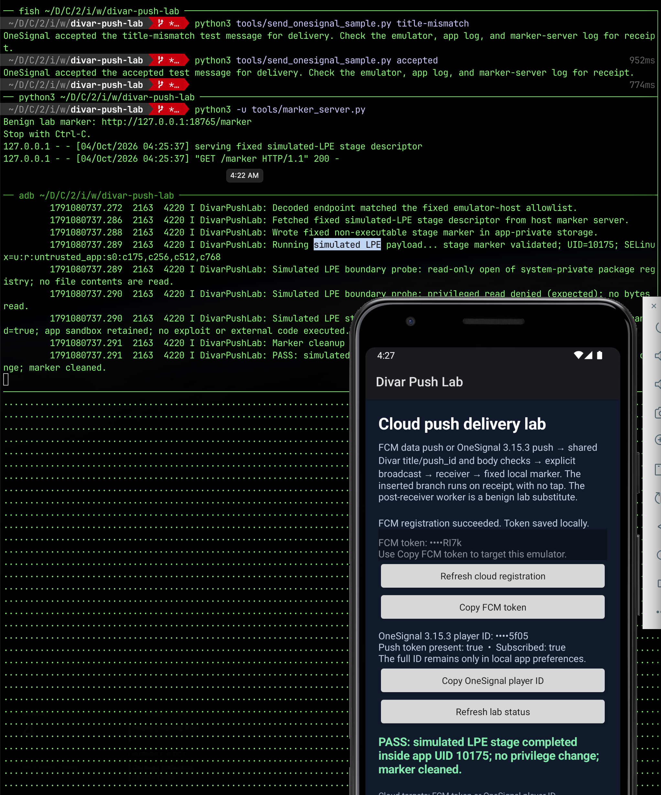
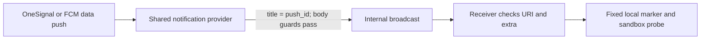

# Divar push-handler lab

A synthetic Android app reproduces the special-push trigger and internal receiver observed in the signed Divar `11.14.20-b` APK ([SHA-256 and code evidence](docs/evidence.md)). It accepts real cloud pushes through OneSignal 3.15.3 or direct FCM. A matching message acts **on receipt**, without a notification tap. The original worker is replaced by a fixed local marker and a precompiled sandbox-denial probe.

This lab does not run the original Divar app, a downloaded payload, or an exploit. Its OneSignal extender suppresses stock SDK display differently from the sampled APK; [the evidence note](docs/evidence.md) explains that boundary.

## Demo

[](docs/evidence/onesignal_cli_simulated_lpe_2026-10-04.mp4)

[Watch the 40-second OneSignal demo](docs/evidence/onesignal_cli_simulated_lpe_2026-10-04.mp4) · [Device log](docs/evidence/onesignal_cli_simulated_lpe_2026-10-04.txt)

<a href="docs/media/live_terminal_emulator_2026-10-04.png"></a>

## Handler path



OneSignal supplies `custom.a`, `title`, and `alert`; Divar's direct FCM adapter forwards data with `source=divar` or `source=default`. The inserted branch requires a nonempty title equal to `push_id` and nonempty `callback_url`, `campaign`, and `action` fields in the body JSON. `campaign` encodes the worker URL; `callback_url` is only a guard. The lab fetches **only** `http://10.0.2.2:18765/marker`, even when the sender encodes another URL. See the [sample messages and field map](docs/sample-events.md).

## Run it

Use JDK 21, Android SDK 34, a Google Play services emulator, Python 3, and `gcloud`. Use your **own** Firebase and optional OneSignal test projects. The [cloud setup guide](docs/setup.md) gives the required permissions and configuration files.

1. Register Android package `org.hamidk.divarpushlab` in Firebase, place its `google-services.json` in `app/`, and authorize your sender for FCM HTTP v1.
2. Build, install, and open the app. Start the marker server in another terminal:

   ```sh
   ./gradlew :app:assembleDebug
   adb install -r app/build/outputs/apk/debug/app-debug.apk
   python3 tools/marker_server.py
   ```

3. Send a matching push and a control through direct FCM:

   ```sh
   python3 tools/send_cloud_sample.py --project YOUR_FIREBASE_PROJECT_ID accepted
   python3 tools/send_cloud_sample.py --project YOUR_FIREBASE_PROJECT_ID title-mismatch
   adb logcat -d -s DivarPushLab:I '*:S'
   ```

4. For OneSignal delivery, complete the [test-app setup](docs/setup.md#onesignal-test-app), then run `python3 tools/send_onesignal_sample.py title-mismatch` followed by `python3 tools/send_onesignal_sample.py accepted`.

A matching push should produce one `GET /marker` and an app `PASS`; the mismatch should not dispatch. The probe attempts a read-only open of a protected Android file, expects denial, reads no bytes, and confirms unchanged UID and SELinux context. API acceptance alone does not prove device delivery; check the emulator and logs. Run local helper tests with `python3 -m unittest discover -s tools -p 'test_*.py'`.

## Research and limits

- Main CTI report ([FA](research/Divar_backdoor_technical_analysis_fa.pdf) / [EN](research/Divar_backdoor_technical_analysis.pdf)) — release chronology, push and HTTP routes, code analysis, and IoCs.
- Livestream whitepaper ([FA](research/Divar_livestream_whitepaper_fa.pdf) / [EN](research/Divar_livestream_whitepaper_en.pdf)) · [presentation](https://youtube.com/live/uGGs-6wP0xE).
- Iranian mobile-app comparison ([FA](research/Iran_mobile_apps_companion_fa.pdf) / [EN](research/Iran_mobile_apps_companion.pdf)).
- [IOC Hunt rules and methods](research/IOC_Hunt/README.md) · [APK release-marker matrix](research/Divar_release_marker_matrix.csv) · [artifact checksums](research/SHA256SUMS).

The lab models one sampled push branch, not the separate HTTP response-header route or the sampled APK's Divar-specific OneSignal REST path. It does not establish that a hostile push was sent through Divar's production account or that a device was exploited. For source and validation details, see [evidence and limits](docs/evidence.md), [OneSignal incident-response leads](docs/divar-onesignal-incident-response.md), [Ramin Farajpour Cami's original analysis](https://gist.github.com/raminfp/a548a2af86108eb40b8bffc5c8f07aaa), and [Hamid Kashfi's follow-up](https://x.com/hkashfi/status/2106147963332633025).

Original lab material is [MIT licensed](LICENSE); the bundled OneSignal SDK has its own [notice](THIRD_PARTY_NOTICES.md). Credentials and the original APK are not included.
